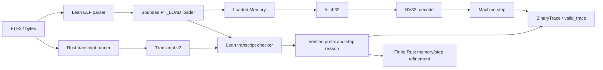

# Architecture

## Pipeline

## Repository Layout

| Directory | Contents |
|---|---|
| `formal/ZkRV32I/Base.lean` | Word32, register file, and memory |
| `formal/ZkRV32I/ISA.lean` | Instruction constructors and decode helpers |
| `formal/ZkRV32I/Machine.lean` | Machine state and `step` |
| `formal/ZkRV32I/Trace.lean` | Trace predicates |
| `formal/ZkRV32I/Binary.lean` | ELF parser/loader, binary steps, and transcript integration |
| `formal/ZkRV32I/Transcript.lean` | Transcript v2 parsing and stop checking |
| `formal/ZkRV32I/Refinement/Memory.lean` | Finite Rust memory model |
| `formal/ZkRV32I/Refinement/Step.lean` | Modeled Rust state and step correspondence |
| `formal/ZkRV32I/Circuit/` | Semantic field and constraint predicates |
| `rust/src/lib.rs` | `no_std` safe RV32I implementation |
| `adversarial/src/transcript.rs` | ELF runner and transcript emitter |
| `scripts/verify_all.sh` | Full verification gate |

## Trust Boundaries

Lean checks formal definitions and proof terms. Rust tests compare tested
behavior and emit transcripts, but they do not produce Lean extraction. The
adversarial harness supplies mutated ELF and transcript inputs to the runner
and Lean checker. It establishes rejection at tested boundaries, not
universal parser or implementation security.

An accepted transcript proves that every recorded row matches its ELF-derived
memory state and Lean transition. It does not independently prove that the Rust
host process generated the row, because the transcript itself is the data
input and the host/run attestation is outside the Lean statement.

## Current Limits

- ELF is bounded to 1 MiB and the transcript memory window to 64 KiB.
- `PT_LOAD` ranges must fit the window and be pairwise disjoint.
- The full ELF ABI and dynamic linking are out of scope.
- Fuel and fault stop reasons are checked against modeled final states and
  transcript fields.
- No compiler, linker, hardware, cryptographic, or external verifier boundary
  is proved.
