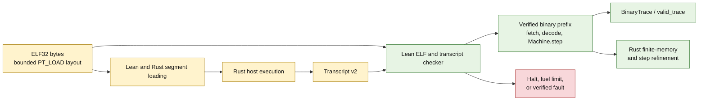
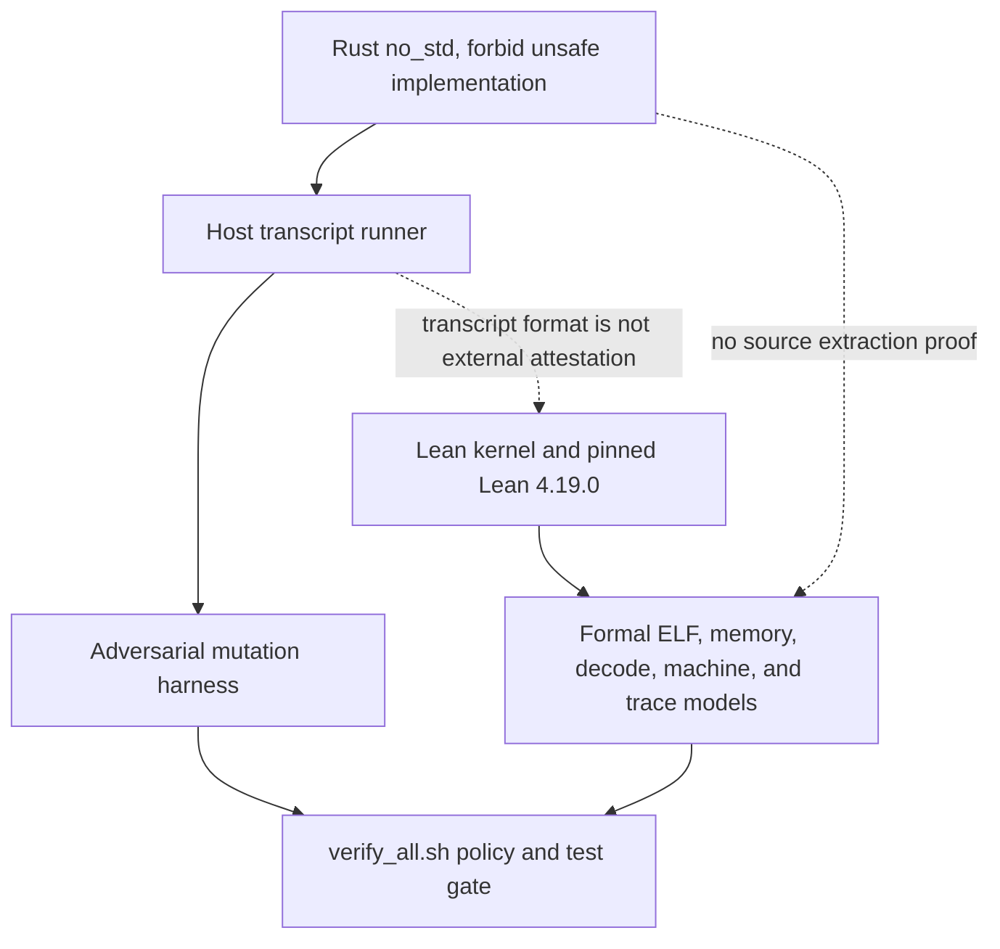

# zkRV32I-Lean

[](https://github.com/shahmeer-khaskheli/zkRV32I-Lean/actions/workflows/ci.yml)

zkRV32I-Lean is an active engineering and formal-methods project for an
RV32I execution model, bounded ELF32 loading, and transcript checking. The
project combines Lean proofs, a `no_std` Rust execution core, and mutation
tests.

This repository is **work in progress**. It does not claim end-to-end
verification of a compiler, linker, processor, cryptographic proof system, or
external verifier.

## Current Verified Scope

The following status was verified on 2026-11-21 with
`bash scripts/verify_all.sh` in WSL:

| Area | Verified result |
|---|---|
| Lean build | Passed |
| Formal source policy | No `sorry`, `admit`, or project-defined `axiom` |
| Axiom audit | 1,631 theorem declarations; dependencies are `propext`, `Quot.sound`, `Classical.choice`, and `Lean.ofReduceBool` |
| RV32I coverage | All 40 modeled instruction variants have Lean machine, Lean finite-model, and Rust step cases |
| Core Rust tests | 17 passed on the WSL host target |
| Adversarial unit tests | 5 passed |
| ELF mutation cases | 9 accepted/rejected cases passed |
| Transcript mutation cases | 8 cases passed |
| Fault-stop cases | 3 valid fault-stop cases passed |
| Rust constraints | `#![no_std]` and `#![forbid(unsafe_code)]` remain enforced |
| RISC-V build check | `riscv32i-unknown-none-elf` Cargo check passed |

These counts describe the current run, not a claim of universal correctness.

## Proof Example

The following theorem is copied from `formal/ZkRV32I/Trace.lean`. It proves
that every row of a valid trace remains 4-byte aligned through its transitions.

```lean
theorem valid_trace_rows_pcAligned (trace : Trace) (htrace : valid_trace trace)
    (index : Nat) (hindex : index < trace.length) :
    pcAligned (trace.get index hindex) := by
  rcases htrace with ⟨hnonempty, hinitial, hsteps⟩
  have hrows : ∀ index (hindex : index < trace.length),
      pcAligned (trace.get index hindex) := by
    intro index
    induction index with
    | zero =>
        intro hindex
        rcases hinitial with ⟨pc, memory, _, hAligned⟩
        simpa [Trace.get] using hAligned
    | succ index ih =>
        intro hindex
        have hprev : index < trace.length :=
          Nat.lt_trans (Nat.lt_succ_self index) hindex
        have hprevAligned := ih hprev
        obtain ⟨instruction, hstep⟩ := hsteps index (by omega)
        exact step_preserves_pcAligned _ instruction _ hprevAligned hstep
  exact hrows index hindex
```

## Verification Pipeline



The pipeline is not one end-to-end theorem across every external boundary.
Lean verifies the bounded ELF and transcript model. Rust emits and tests
execution transcripts. The adversarial harness mutates inputs and expects
acceptance or rejection. The current finite refinement connects modeled Rust
finite states to Lean `Machine.step`.

## Trust Boundaries



| Layer | Guarantee | Remaining boundary |
|---|---|---|
| Lean kernel | Definitions and proofs compile; policy checks find no project-defined axioms | Standard Lean foundations remain dependencies |
| ELF and memory | Bounded ELF parsing/loading invariants, disjoint segments, and geometry preservation are proved | No complete ELF ABI or external-loader equivalence |
| Transcript | Every accepted row is checked against fetch, decode, `Machine.step`, and snapshots | `fuel_limit` is a transcript record, checked for internal consistency, not hardware attested |
| Rust core | `no_std`, no unsafe code, selected instruction behavior tested | No compiled Rust source extraction or compiler-output equivalence proof |
| Full binary scope | Restricted accepted classes and bounded prefixes have Lean evidence | No arbitrary ELF, full RV32I conformance, or hardware proof |
| ZK constraints | Lean semantic row predicates and trace projections exist | No production AIR/R1CS, prover, verifier, or cryptographic proof |

## Repository Layout

| Path | Responsibility |
|---|---|
| `formal/` | Lean 4 semantics, ELF loading, traces, refinements, and constraint predicates |
| `rust/src/lib.rs` | `no_std`, `forbid(unsafe_code)` RV32I implementation |
| `rust/src/bin/firmware.rs` | Bare-metal firmware entry used in the Rust workspace |
| `adversarial/` | Host transcript runner and adversarial/unit tests |
| `scripts/` | Verification policies, mutation harness, and proof checks |
| `docs/` | Detailed technical documentation |
| `release/` | Current release-oriented scope and limitations |

## Transcript v2

The Rust runner emits `zkrv32i-execution-transcript` version 2. It contains:

- ELF bytes;
- initial state;
- each step's PC, raw instruction word, decoded record, and full snapshot;
- one stop reason: `halt`, `fuel_limit`, or `fault`.

The Lean checker independently parses ELF bytes and the transcript. It
requires:

- ELF size at or below 1 MiB;
- at least one loadable segment;
- pairwise-disjoint loadable memory ranges;
- a bounded 64 KiB memory window based on the lowest loadable address;
- aligned entry inside an executable `PT_LOAD`;
- matching ELF bytes and initial snapshot;
- matching PC, word, decode result, `Machine.step`, and output snapshot for
  every row.

For `fuel_limit`, Lean requires `steps == limit <= 256` and a running final
state. The Rust runner supplies `limit`, but this is not proof that an external
machine ran exactly that many steps or that a hardware limit value is correct.

## Exact Prerequisites

Use Linux, macOS, or WSL. The repository pins Lean 4.19.0 in
`lean-toolchain` and Rust 1.97.1 in `rust-toolchain.toml`. Run commands from
the repository root.

| Tool | Current verified configuration |
|---|---|
| Lean | `leanprover/lean4:v4.19.0` |
| Lake | `lake` on `PATH`, or `${LAKE_BIN:-lake}` when explicitly configured |
| Rust | `rustc`/`cargo` 1.97.1 |
| Host target | `$(rustc -vV | sed -n 's/^host: //p')` |
| RISC-V target | `riscv32i-unknown-none-elf` |

Install the pinned toolchains:

```bash
curl https://raw.githubusercontent.com/leanprover/elan/master/elan-init.sh -sSf | sh -s -- -y
rustup toolchain install 1.97.1
rustup target add riscv32i-unknown-none-elf
```

## Verified Commands

Build Lean:

```bash
${LAKE_BIN:-lake} build
```

Run the Lean axiom policy:

```bash
bash scripts/check_axiom_policy.sh
```

Check the no-`sorry` and no-`admit` policies:

```bash
bash scripts/check_no_sorry.sh
bash scripts/check_no_admit.sh
```

Check the Rust library host tests:

```bash
cargo test --locked --target "$(rustc -vV | sed -n 's/^host: //p')"
```

Check the bare-metal target:

```bash
cargo check --locked --target riscv32i-unknown-none-elf
```

Run the adversarial Rust unit tests:

```bash
cargo test --locked --manifest-path adversarial/Cargo.toml \
  --target "$(rustc -vV | sed -n 's/^host: //p')"
```

Build the adversarial host runner:

```bash
cargo build --locked --manifest-path adversarial/Cargo.toml \
  --target "$(rustc -vV | sed -n 's/^host: //p')"
```

Run the complete gate:

```bash
bash scripts/verify_all.sh
```

`verify_all.sh` runs the source policies, Lean build, axiom audit,
RISC-V Cargo check, host Rust tests, adversarial Rust tests, host runner build,
and the ELF/transcript mutation harness.

## Main Limitations

- No arbitrary ELF32 ABI implementation is proved.
- The bounded transcript profile currently allows only a 64 KiB memory window
  and 1 MiB ELF byte limit.
- No arbitrary-length, general-control-flow binary result supersedes the
  restricted accepted classes and bounded-prefix evidence.
- No Rust source extraction or compiled machine-code equivalence is proved.
- Stop faults are checked at the Lean model boundary. Rust fault names and
  Lean classification are tested, but not cryptographically or externally
  attested.
- No production AIR/R1CS, prover, verifier, cryptographic soundness, or
  zero-knowledge claim exists.
- No RTL, FPGA, hardware, compiler, linker, OS, or side-channel claim exists.

## Documentation

- [Documentation index](docs/index.md)
- [Architecture](ARCHITECTURE.md)
- [Binary verification scope](BINARY_VERIFICATION_SCOPE.md)
- [Known limitations](release/KNOWN_LIMITATIONS.md)
- [Installation](docs/INSTALLATION.md)
- [Roadmap](VERIFICATION_ROADMAP.md)

## License

Licensed under the Apache License, Version 2.0. See [LICENSE](LICENSE).
