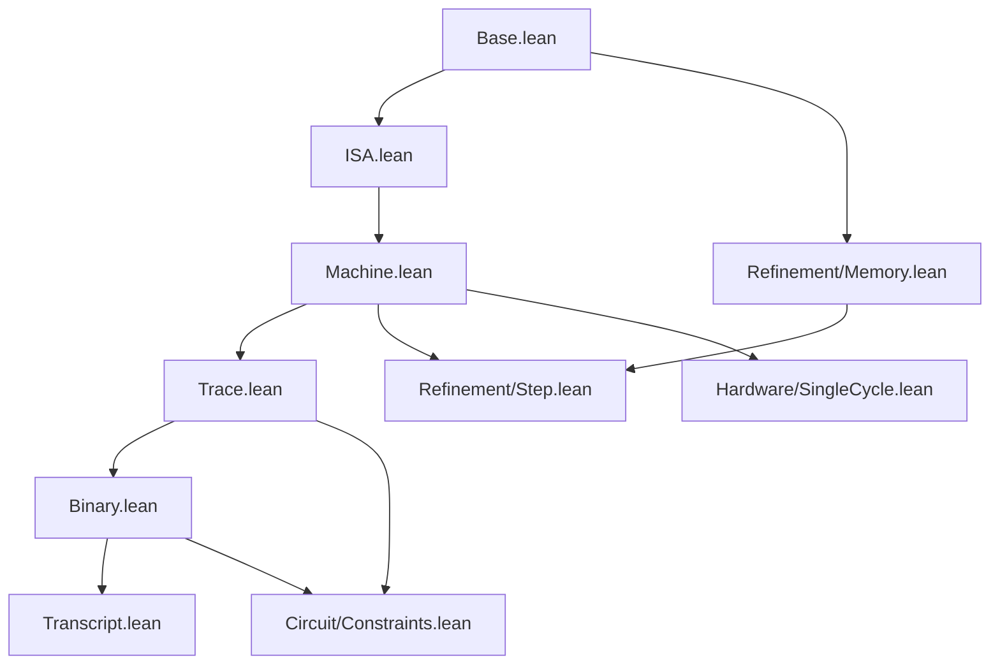

# Theorem and module map

The arrows in the module map describe source imports. They are not external
implementation refinements.

## Directly relevant results

| Result | Scope |
|---|---|
| `ELF32Image.loadMemory_success_preserves_geometry` | Loading preserves memory base and size |
| `loadSegmentBytes_commute_of_disjoint` | Disjoint segment writes and BSS tails commute |
| `successful_disjoint_segment_loads_commute` | Two successful disjoint loads produce the same final memory in either order |
| `accepted_sound` | An accepted transcript yields a binary-valid/valid trace |
| `VerifiedStopReason.halt_implies_terminal` | A verified halt requires the halted terminal state |
| `VerifiedStopReason.notHalt_implies_running` | Fuel/fault reasons require the running state |
| `stepAt_finite_refinement` | Every accepted row is finite-memory/refinement related |
| `accepted_steps_refine_finite_model` | All accepted transcript steps correspond to finite modeled Rust steps |

The 1,631-declaration count reported by the axiom audit is an inventory count.
It does not measure proof independence or external implementation coverage.
